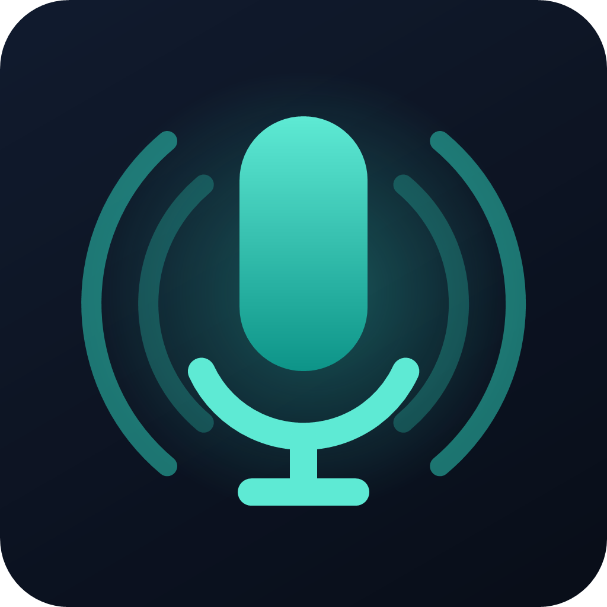
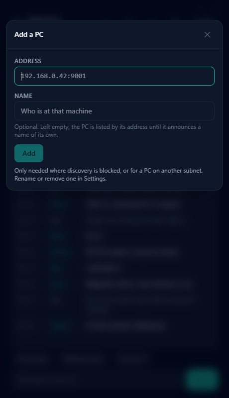
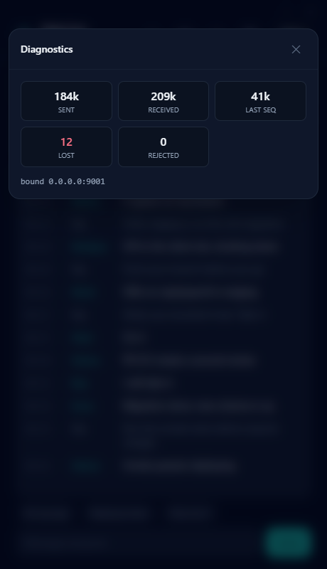

<div align="center">



# Zetta Com

**An intercom for the computers on your local network.**<br>
Hold a key, and the people you pick hear you.

[](https://github.com/joyahmed/zetta-com/releases/latest) [](#install) [](LICENSE)

### [⬇ Download Zetta Com](https://github.com/joyahmed/zetta-com/releases/latest)

Free · No internet · No accounts · No server · Rust + Tauri 2 + React

</div>

<br>

## Why I built this

We needed to call each other across a room full of computers, and walking over every time was slow. My first try was a pile of batch files, PowerShell and ffmpeg. It worked, mostly. But almost every problem came from the scripts around it, not the intercom: old PowerShell quirks, line endings, an installer that hid its own errors.

The one that ended it was the firewall. The program talking on the network was `powershell.exe`, and when Windows blocked it, a PC just went silent and nobody knew why. So I made a real app with its own name in the firewall.

Two good things came with it. Machines now find each other on their own. And because each one sends a small "I'm here" signal, the app can tell you when somebody is **not** listening. The old one never could.

## A quick look

<table>
  <tr>
    <td width="50%" valign="top">
      <br>
      <b>Add one by hand.</b> If a machine can't be found on its own, type its address and give it a name.
    </td>
    <td width="50%" valign="top">
      <br>
      <b>Is it working?</b> Diagnostics counts packets sent, received, lost and rejected. Moving numbers mean yes.
    </td>
  </tr>
</table>

## Highlights

- 🎙 **Push to talk**: hold <kbd>F8</kbd> and whoever is selected hears you. Nothing is sent unless the key is down.
- 🎯 **One, a group, or everyone**: <kbd>Ctrl</kbd>+<kbd>1</kbd>…<kbd>9</kbd> talks to one PC, <kbd>Ctrl</kbd>+<kbd>0</kbd> to the whole room, <kbd>F7</kbd> back to whoever spoke last.
- 🔎 **Finds everyone**: machines on the same network show up by themselves. No addresses to type.
- 👀 **Knows who's away**: a PC that goes quiet greys out within 7 seconds.
- 💬 **Messages**: type one, or send a saved preset with a key. A ✓ shows once everyone got it.
- ⌨️ **Works from any app**: the keys are global, so you talk without leaving what you are doing.
- 🪶 **Small**: a 2.7 MB Windows installer. It lives in the tray and can start with your computer.

<details>
<summary><b>Everything it does</b> (click to open)</summary>

### Talk

- Hold <kbd>F8</kbd> to talk to whoever is selected. Let go and it stops.
- <kbd>Ctrl</kbd>+<kbd>1</kbd>…<kbd>9</kbd> (hold) talks to that PC. The numbers follow the order of your PC list.
- <kbd>Ctrl</kbd>+<kbd>0</kbd> (hold) talks to everyone.
- <kbd>F7</kbd> (hold) talks back to whoever spoke to you last.
- Saved groups (like "Devs" or "Front desk") sit next to Everyone. Members who are offline are skipped, never swapped for the whole room.
- Half duplex on purpose: your speakers go quiet while you talk, so there is no echo.
- An **I'm on headphones** switch keeps your speakers on while you talk, so two people can talk over each other like a phone call.

### Messages

- Type a message, or fire a saved preset with a key.
- <kbd>Ctrl</kbd>+<kbd>Alt</kbd>+<kbd>1</kbd>…<kbd>9</kbd> messages that PC, <kbd>Ctrl</kbd>+<kbd>Alt</kbd>+<kbd>0</kbd> messages everyone.
- They show as normal system notifications when the window is hidden.
- Each message you send shows a ✓ when everyone got it, or `✓ 3/6` while some have not. Hover to see who.

### Who's there

- Machines on the same network find each other by themselves (mDNS).
- Each one sends a small "I'm here" signal every 2 seconds. Somebody who goes quiet greys out within 7.
- Give each machine a real name. `DESK-04` means nothing; a person's name does.
- The list tells you when someone runs a different version from you, which helps when you update every PC.

### Sounds

- A chime for a message you are not looking at.
- A short blip when someone starts talking to you.
- Put a bell on a PC to hear when it goes offline or comes back.
- Each sound has its own switch and a Test button, with one shared volume.

### Everyday

- Lives in the tray, and can start with your computer (a switch in Settings). Closing the window only hides it, so you still hear people. **Quit** is in the tray menu.
- <kbd>F9</kbd> starts or stops it. <kbd>Ctrl</kbd>+<kbd>Alt</kbd>+<kbd>T</kbd> opens the window.
- Every shortcut is listed in the app, including any that another program took first, so a dead key never looks like a broken app.
- Diagnostics shows packets sent, received, lost and rejected.

</details>

## Install

Download from the [Releases page](https://github.com/joyahmed/zetta-com/releases/latest). Install it on every PC that should talk.

| System | File | First launch |
|---|---|---|
| **Windows** | `Zetta.Com_<version>_x64-setup.exe` | It asks for administrator, because it adds a firewall rule for the app. Windows may warn you: click **More info**, then **Run anyway**. |
| **Mac** (Apple silicon) | `Zetta.Com_<version>_aarch64.dmg` | Drag it to Applications. macOS says the app is "damaged" because it isn't signed yet. Run `xattr -cr "/Applications/Zetta Com.app"` once after each download. Then turn on **System Settings > Privacy & Security > Local Network** for it, or it will hear nobody. |
| **Linux** | `Zetta.Com_<version>_amd64.deb` or `.rpm` | `sudo apt install ./Zetta.Com_<version>_amd64.deb`, or install the `.rpm` with your package manager. |

There is no Intel Mac build and no AppImage. On those, build it yourself (below).

**It needs your network open on one port.** Voice, messages and the "I'm here" signal all use **UDP 9001** (you can change it in Settings; every PC must use the same one). Finding each other uses **UDP 5353**. On Windows the installer adds the firewall rule for you. If you run a build without installing it and Windows asks, click **Allow**. If you cancel, Windows quietly blocks it. To fix that, as administrator:

```powershell
netsh advfirewall firewall delete rule name="Zetta Com"
netsh advfirewall firewall add rule name="Zetta Com" dir=in action=allow program="C:\Program Files\Zetta Com\zetta-com.exe" protocol=udp profile=any enable=yes
```

## Watch it

See it running, and more of what I build: [youtube.com/@joysbuilds](https://www.youtube.com/@joysbuilds).

## Privacy

- No account, no sign-in, no analytics. It never calls anything outside your own network.
- Your voice goes straight from your PC to theirs. There is no server in between.
- Your settings are one file on your machine. Delete it and the app starts fresh.

**Please read this:** on a normal network, anyone else on the same network can hear and send to Zetta Com. They don't even need the app. Use it on a network you trust, like your office or home LAN. Don't use it for anything you would not say out loud in that room.

## Build from source

You need [Rust](https://rustup.rs), [Bun](https://bun.sh) and Tauri 2's system libraries for your OS. On Windows you also need [CMake](https://cmake.org/download/) (for the Opus audio library). On Linux, `libasound2-dev`.

```
bun install
bun run tauri build
```

The installers land in `src-tauri/target/release/bundle/`. Each OS builds only its own.

Before a pull request, both of these must be clean: `cd src-tauri && cargo check` and `bunx tsc --noEmit`. [CONTRIBUTING.md](CONTRIBUTING.md) has the rest, and [docs/PLAN.md](docs/PLAN.md) has the decisions and what I turned down.

It's Rust and Tauri 2 on the back (Opus for audio), React and Tailwind on the front.

## License

MIT. See [LICENSE](LICENSE).

---

<div align="center">

I build tools I use myself, from Bangladesh. If Zetta Com saves you a walk across the room, that makes me happy.<br>
Found a bug or want something? [Open an issue](https://github.com/joyahmed/zetta-com/issues).

**Joy**

</div>
